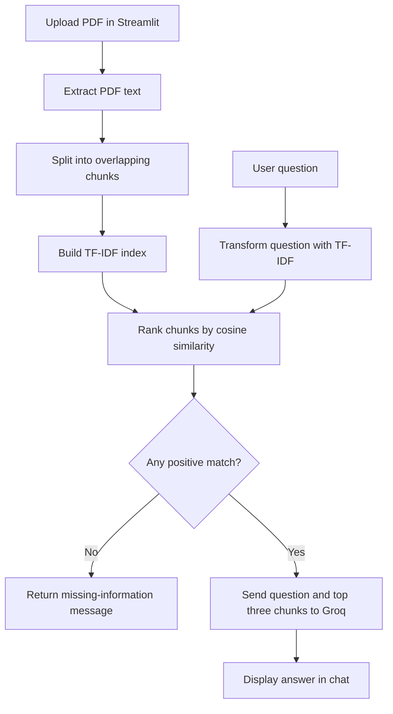

RAG-Based University Assistant Chatbot
A Python application that answers university-related questions using the contents of an uploaded PDF. The main application uses Streamlit, TF-IDF retrieval, and the Groq Chat Completions API.

This README describes the supplied source code. The main application is University_Assistant.py; the v2/ directory contains a separate Flask/SPARQL prototype that requires additional configuration.
Project Purpose
University information can be distributed across admission brochures, student handbooks, and FAQ documents. This application lets a user upload a PDF and ask questions about its contents through a chat interface.

For example, a user can upload an admission guide and ask:
- What documents are required for admission?
- What is the admission process?
- What scholarships are available?
- Is hostel accommodation available?
- What is the fee structure?
- What programmes are offered?
The answer depends on information available in the uploaded PDF. The application does not connect to a live university student database.
Implemented Features
- PDF upload through the Streamlit sidebar.
- PDF text extraction using PDFPlumberLoader.
- Document splitting into overlapping text chunks.
- Local TF-IDF indexing and cosine-similarity retrieval.
- Retrieval of up to three matching chunks per question.
- Answer generation through Groq.
- Prompt instructions to keep answers within three sentences and acknowledge missing knowledge.
- An explicit fallback when no positive-similarity chunk is found.
- Chat display with user and assistant messages.
- A Clear chat button and six sample-question buttons.
- Dashboard cards showing document name, indexed chunk count, and message count.
- API request timeout and error reporting.
The current interface does not display source excerpts, page citations, or retrieval scores.
Technology Stack
Component	Actual implementation
Language	Python
Main web interface	Streamlit
PDF loading	LangChain Community PDFPlumberLoader
Text splitting	RecursiveCharacterTextSplitter
Text representation	scikit-learn TfidfVectorizer
Retrieval ranking	scikit-learn cosine similarity
Answer generation	Groq Chat Completions API
Default model identifier	llama-3.1-8b-instant
HTTP client	Requests
Upload storage	Local files under chat-with-pdf/pdfs/
Search index	In-memory Python objects and sparse TF-IDF matrix
Alternate prototype	Flask, NLTK, SPARQLWrapper, external Fuseki and LLaMA endpoints

The main application does not use Gemini, a neural embedding model, Chroma, FAISS, React, FastAPI, or Supabase. Its retrieval uses lexical TF-IDF vectors. RAG does not require a neural vector database: this implementation retrieves text locally before asking the model to generate an answer.
Architecture

How It Works
1. Upload and Extract
upload_pdf() saves the uploaded file under chat-with-pdf/pdfs/. load_pdf() uses PDFPlumberLoader to extract the PDF's text.

Existing PDFs are included in the archive, but the Streamlit app does not automatically index them at startup. Upload a PDF through the sidebar to begin.
2. Split the Text
split_text() configures:
RecursiveCharacterTextSplitter(
    chunk_size=1000,
    chunk_overlap=200,
    add_start_index=True
)
These sizes refer to characters under the splitter's default length function, not tokens. Overlap helps retain context near chunk boundaries.
3. Build the Retrieval Index
index_documents() removes blank chunks, stores their text, and fits:
TfidfVectorizer(stop_words="english")
TF-IDF gives more weight to words that help distinguish passages. It does not train or fine-tune the language model.

The index keeps only chunk text. Page and source metadata from the loader are not preserved in documents_store.
4. Retrieve Matching Chunks
retrieve_relevant_docs(query, top_k=3) transforms the question with the fitted vectorizer, computes cosine similarity, sorts the scores, and returns up to three chunks whose scores are greater than zero.

There is no minimum relevance threshold beyond > 0. A weak keyword match may therefore be passed to the model, while a paraphrase with no shared vocabulary may return no results.
5. Generate an Answer
ask_assistant() joins the retrieved passages and calls answer_question_with_groq(). The request uses:
- Endpoint: https://api.groq.com/openai/v1/chat/completions
- Default model: llama-3.1-8b-instant
- Temperature: 0.2
- HTTP timeout: 60 seconds
The prompt requests a concise answer grounded in the context, with a maximum of three sentences. These are prompt instructions rather than guarantees enforced by output validation.

When retrieval finds no matching passage, the app returns:
I could not find relevant information in the uploaded PDF.

6. Display Conversation
Messages are stored in st.session_state.messages and rendered in the interface. Previous messages are not included in the Groq request. Consequently, visible chat history does not provide conversational memory for follow-up questions such as “What about its fees?”
Project Structure
Run commands from the inner project directory containing University_Assistant.py and requirements.txt. The uploaded archive has two nested folders with the same project name.
RAG-Based-University-Assistant-Chatbot-main/
├── University_Assistant.py       # Main Streamlit application
├── requirements.txt             # Shared pinned dependencies
├── README.md
├── .gitignore
├── university_faq.pdf            # Included sample document
├── chat-with-pdf/
│   └── pdfs/
│       ├── frontpageuma.pdf
│       └── university_faq.pdf
└── v2/
    ├── app.py                   # Separate Flask application
    ├── pipeline.py              # SPARQL retrieval and LLaMA calls
    └── templates/
        └── index.html           # Flask chat interface
The supplied archive also includes a Windows virtual environment. Create a fresh environment on your own computer rather than reusing the bundled one.
Installation
Prerequisites
- Python 3.10 is the intended setup shown in the supplied project documentation; a clean dependency installation was not verified in this review.
- Internet access for package installation and Groq requests.
- Your own Groq API key.
- A text-based PDF containing university information.
Windows PowerShell
Open a terminal in the directory containing University_Assistant.py:
py -3.10 -m venv .venv
.\.venv\Scripts\Activate.ps1
python -m pip install --upgrade pip
python -m pip install -r requirements.txt
If activation is blocked, you can use the environment's interpreter directly:
.\.venv\Scripts\python.exe -m pip install -r requirements.txt
.\.venv\Scripts\python.exe -m streamlit run University_Assistant.py
macOS / Linux
From the same project directory, using a compatible Python interpreter:
python3 -m venv .venv
source .venv/bin/activate
python -m pip install --upgrade pip
python -m pip install -r requirements.txt
Configure Groq
Create .env in the current project directory:
GROQ_API_KEY=your_own_groq_api_key
The app checks the process environment first, then reads GROQ_API_KEY from the local .env file. Its custom loader does not load other .env variables.

To override the model, set GROQ_MODEL in the terminal environment. Adding it only to .env does not override the model in this implementation.

PowerShell example:
$env:GROQ_MODEL = "llama-3.1-8b-instant"
macOS / Linux example:
export GROQ_MODEL=llama-3.1-8b-instant
The identifier above is the source code's default, not a claim of current provider availability. If the provider rejects it, configure a model available to your account. Restart the app after changing keys or model settings because configuration is read at script execution.

Keep the API key private and do not commit .env to a public repository.
Start the Main Application
python -m streamlit run University_Assistant.py
Open the local address printed in the terminal, normally http://localhost:8501.
1. Upload a PDF from the sidebar.
2. Confirm that its filename and indexed chunk count appear.
3. Enter a question or choose a sample question.
4. Read the answer in the conversation panel.
5. Use Clear chat to clear the conversation. This does not delete uploaded files.
Dependencies Included in requirements.txt
streamlit==1.35.0
flask==3.1.3
langchain==0.1.20
langchain-community==0.0.38
langchain-text-splitters==0.0.2
pdfplumber==0.10.3
numpy==1.26.4
scikit-learn==1.4.2
requests==2.31.0
SPARQLWrapper==2.0.0
nltk==3.9.2
Flask, SPARQLWrapper, and NLTK support the separate v2 implementation. The main Streamlit app does not import them. The list is reproduced from the supplied source; clean installation and compatibility still need verification.
Alternate Version: Flask + SPARQL (v2/)
This is a separate retrieval approach, not a backend used by the Streamlit app.

Its pipeline:
1. Look for a university name in the question: Air University, FAST, NUST, or National University.
2. Extract word tokens and remove English NLTK stopwords.
3. Build a SPARQL query that searches FAQ question text using keyword matches.
4. Retrieve FAQ question/answer pairs from an external Fuseki endpoint.
5. Send the results and user question to a configured LLaMA endpoint.
6. Display the generated answer in a Flask HTML chat interface.
Required Configuration
In v2/pipeline.py, replace the literal placeholders:
FUSEKI_URL = "Your fuseki endpoint"
LLAMA_API_URL = "Your llama endpoint"
You must supply a populated RDF dataset compatible with the query's http://example.org/unifaq# namespace and its FAQ, question, answer, text, and university relationships. No Fuseki deployment or RDF dataset is included in the inspected application files.

The LLaMA integration posts model and prompt and expects choices[0].text in the response. Your endpoint must implement that contract, or the integration must be adapted.

pipeline.py calls nltk.download("stopwords") at import time; the corpus must be available or downloadable.

After configuring these dependencies:
cd v2
python app.py
The development server normally uses http://127.0.0.1:5000. The source enables Flask debug mode; disable it before any production deployment.
Actual Flask Routes
Method	Route	Purpose
GET	/	Render the chat page
POST	/api/ask	Accept a question and return an answer

Request:
{"query": "What scholarships are available at NUST?"}
Response shape:
{"answer": "Generated answer text"}
No PDF upload API, administrator API, authentication, or persistent chat API is implemented in this version.
Verification Status
All three application Python files passed static syntax parsing during this source review. This establishes syntax validity only.

The application was not started, dependencies were not installed, and no paid or authenticated Groq, Fuseki, or LLaMA request was made. No accuracy, response-time, or reliability result is claimed. No automated test suite was found among the extracted application files.
Suggested Manual Checks
Scenario	Expected behaviour or limitation to verify
Launch without a PDF	Interface asks for a PDF
Upload a readable PDF	Filename and nonzero chunk count appear
Ask a supported question	Answer agrees with the PDF
Ask with no matching vocabulary	Missing-information fallback appears
Missing Groq key	Missing-key error appears when generation is attempted
Invalid key or rejected model	Provider error appears in chat
Clear chat	Messages reset; uploaded file remains
Follow-up needing previous context	May fail because history is not sent to the model
Scanned PDF with no text	May fail indexing; OCR is not implemented
Restart application	In-memory index is not restored automatically

Evaluate retrieval quality and answer correctness using manually checked questions and supporting PDF passages before claiming performance metrics.
Current Limitations
- Only one currently uploaded PDF is indexed at a time; combined multi-document retrieval is absent.
- Retrieval uses lexical similarity and can miss synonyms or paraphrases.
- The Streamlit script reloads and reindexes the uploaded PDF on reruns; it does not cache the index.
- Search state uses module-level variables rather than a deliberately isolated, persistent per-user index.
- Uploads use the original filename in a shared directory; identical names can overwrite files. Safe names, isolation, and cleanup are needed before shared hosting.
- Text extraction occurs outside the indexing exception handler, so some PDF errors may interrupt the app.
- No OCR, source citations, confidence scoring, or answer verification is implemented.
- No authentication, role management, student-record integration, or database-backed conversation history is present.
- Relevant PDF excerpts and the current question are sent to Groq for generation; processing is not fully local.
- Model grounding instructions do not eliminate unsupported answers or document prompt injection.
- The alternate Flask UI inserts user and assistant text with innerHTML; use safe text rendering before exposing it to untrusted input.
- The alternate Flask app exposes exception text and uses development defaults; production error handling and server configuration remain necessary.
Future Improvements
- Preserve and display document title, page number, and supporting passages.
- Add session-isolated indexes and safe upload storage.
- Cache document processing using content hashes.
- Add neural or hybrid retrieval and a tuned relevance threshold.
- Add history-aware question rewriting for follow-up questions.
- Support multiple PDFs and document replacement/deletion.
- Add OCR for scanned documents.
- Add authentication and access-controlled knowledge bases.
- Add prompt-injection handling and grounding evaluation.
- Build automated tests and record measured evaluation results.
Attribution and License
The original supplied README credits Sohaib Ahmed Bazaz and Muhammad Umar. Preserve attribution and confirm ownership and reuse permissions before publishing modifications.

No project LICENSE file was found in the inspected application files. Do not assume a reuse license. Sample university documents may have separate usage restrictions.
